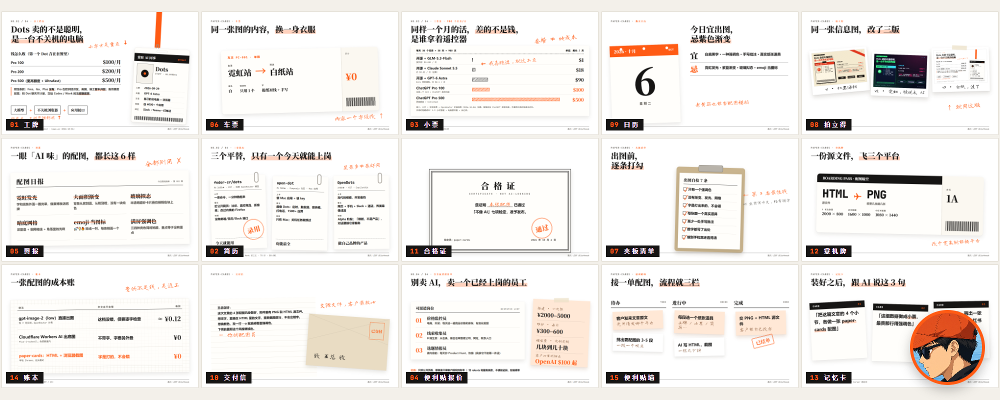

# paper-cards · 不像 AI 的配图 skill



AI 生成的配图，一眼就能认出来：霓虹发光、紫蓝渐变、玻璃卡片、emoji 当图标，中文还经常错字。

paper-cards 反过来做：**白底黑字、只用一个强调色、手写批注、真实纸张道具**（工牌、简历、小票、车票、日历、便利贴……）。每张图都是一段 HTML，用本地浏览器截图成 PNG。

- 中文一个字都不会错：字是打出来的，不是画出来的
- 0 成本：不调生图 API，本地 Chrome 截图
- 能改：交给客户的是 HTML 源文件，改字、换色都是改一行

## 安装

Claude Code、Codex、Cursor 等支持 skill 的 agent 都能用：

```bash
npx skills add LIAlia111/paper-cards
```

截图需要本机有 Node.js 和 Chrome（或 Edge），第一次用在 skill 目录里装一下依赖：

```bash
npm i
```

找不到浏览器时设置 `CHROME_PATH` 环境变量指向 chrome.exe。

## 装好之后，直接跟 agent 说

- 「把这篇文章的 4 个小节，各做一张 paper-cards 配图」
- 「这组数据做成小票，最贵那行用强调色」
- 「同样内容，再出一张 1080×1440 的小红书竖图」

## 自己手动渲染

```bash
node scripts/render.mjs examples/gallery.html out          # 渲染页面里所有 .board
node scripts/render.mjs examples/gallery.html out b05,b14  # 只渲染指定 id
```

## 里面有什么

- `SKILL.md`：agent 的工作流、道具怎么选、出图自检 7 条
- `assets/theme.css`：配色、字体、纸张和道具组件
- `examples/gallery.html`：剪报、车票、夹板清单、拍立得、撕页日历、交付信、合格证、登机牌、记忆卡、账本、便利贴墙
- `examples/dots-article.html`：一篇真实文章的整套图（工牌、简历、小票、报价便利贴 + 5:2 封面）
- `scripts/render.mjs`：按 id 截图

`examples/dots-article.html` 封面里的头像是作者本人形象，没有放进仓库，换成你自己的 `examples/img/avatar.jpg` 即可。

## 作者

嘉佬 Lief · X [@liefmusk](https://x.com/liefmusk)。用它做出来的图欢迎 @ 我，好看的道具我收进 gallery。

MIT License
